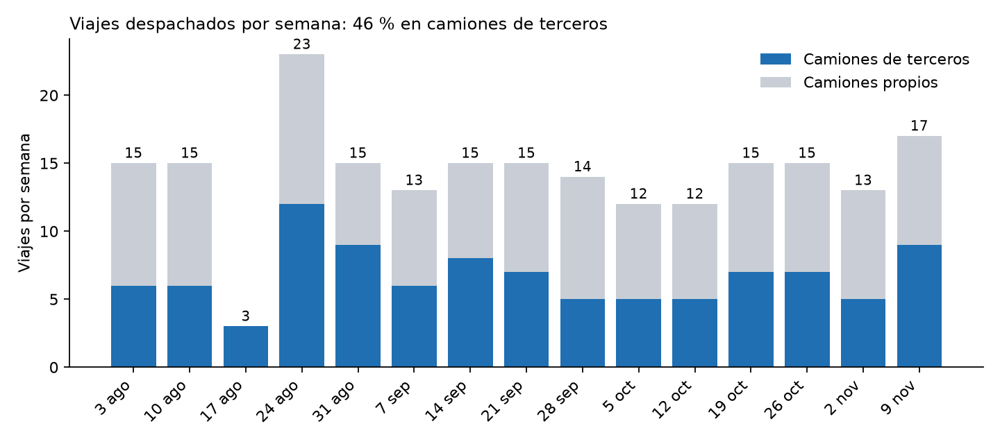
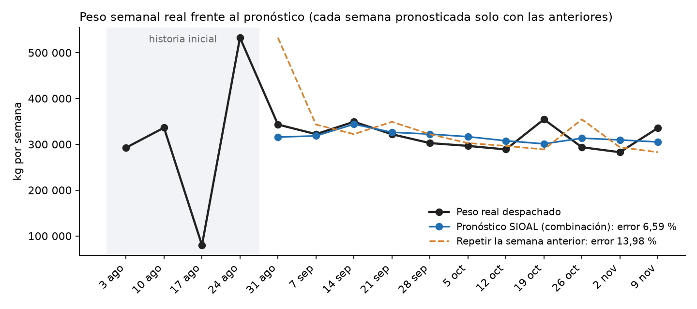
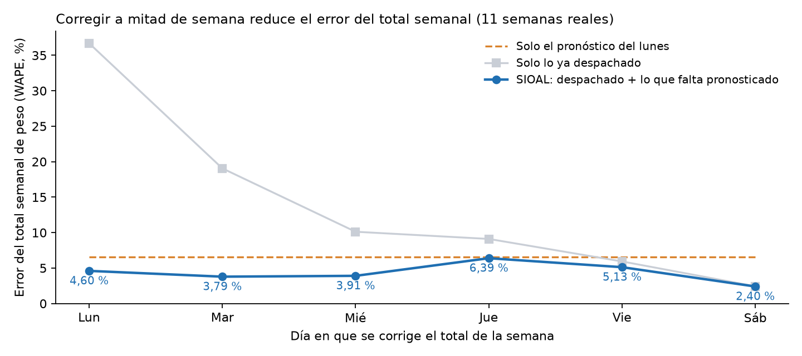
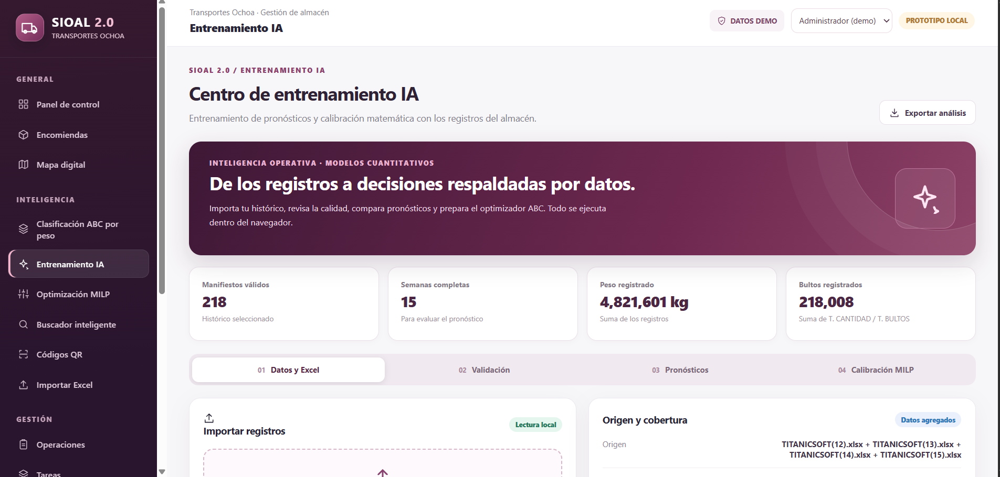
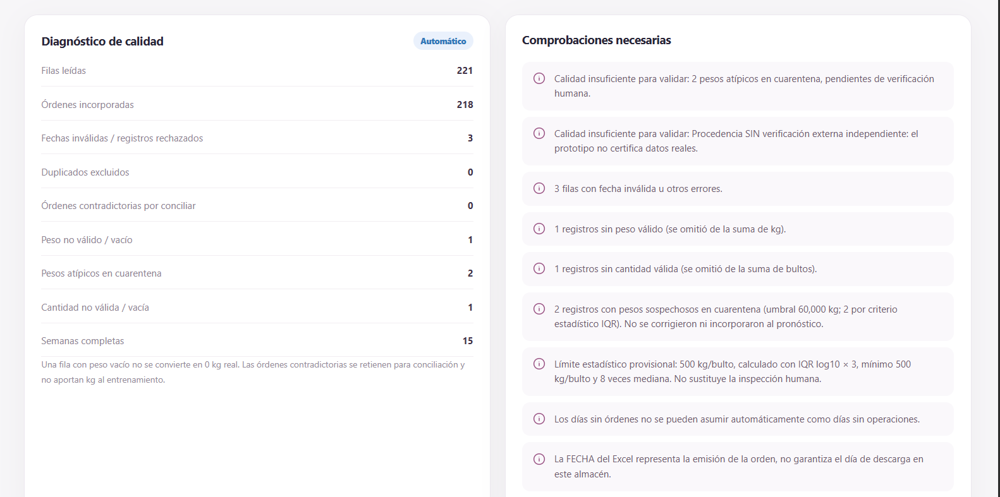
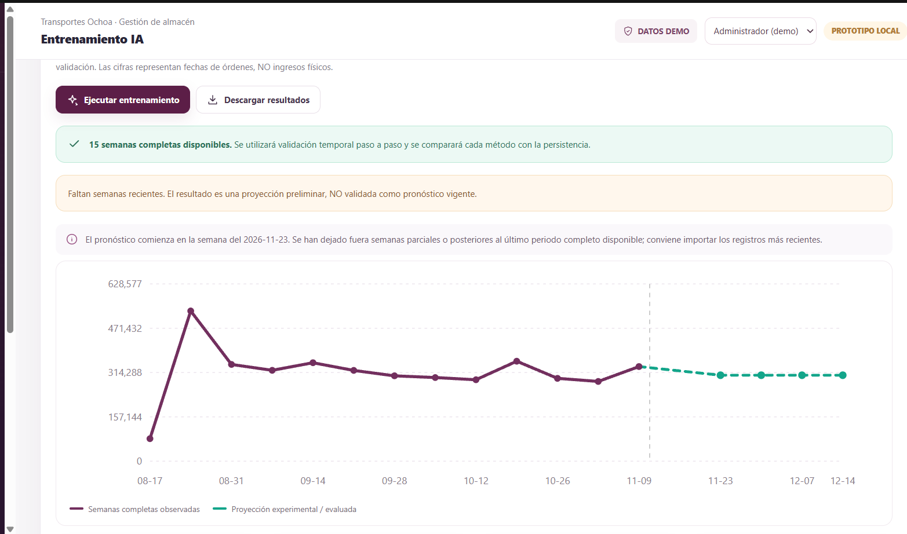

# SIOAL — Sistema de organización de almacén y pronóstico de carga

Prototipo desarrollado para la sede de **Juliaca** de una empresa de transporte de carga (Transportes Ochoa).
Une dos partes:

| Parte | Carpeta | Qué hace |
|---|---|---|
| **Aplicación web** | [`sioal-web/`](sioal-web/) | Registro y ubicación de encomiendas por zonas A/B/C, clasificación ABC, optimización de ubicaciones, alertas, códigos QR y **pronóstico de la carga semanal** a partir de los Excel de TITANICSOFT. |
| **Modelos en Python** | [`modelo/`](modelo/) | Réplica independiente de los modelos de la app para **verificar** que calcula bien y **evaluar** el error con los datos reales. |

> Aplicación publicada: **https://gestion-sioal.netlify.app**

---

## 1. Ver la aplicación

La app es **estática**: HTML, CSS y JavaScript puro, sin servidor, sin base de datos y sin instalación.

**Opción A — En línea:** abrir https://gestion-sioal.netlify.app

**Opción B — En tu computadora:**

1. Descarga el repositorio (botón verde **Code → Download ZIP**) o clónalo:
   ```bash
   git clone <URL-del-repositorio>
   ```
2. Abre `sioal-web/index.html` con doble clic en Chrome o Edge. Listo.

   Para usar la cámara del lector QR conviene servirla en local:
   ```bash
   cd sioal-web
   python -m http.server 8080      # luego abrir http://localhost:8080
   ```

### Cómo se guardan los datos

- Todo se guarda en el **navegador** (`localStorage`), no en un servidor.
- Por eso, **cada computadora y cada navegador tienen sus propios datos**. Si abres la app en otra
  computadora verás los datos de demostración hasta que importes tus Excel.
- Para pasar los datos de una computadora a otra: **Configuración → exportar respaldo (JSON)** y luego
  importarlo en la otra.
- La primera vez la app muestra **datos de demostración** (sintéticos). Aparece el aviso “DATOS DEMO”.

### Cargar los datos reales (pronóstico)

1. Ir a **Entrenamiento IA → 01 Datos y Excel**.
2. **Elegir archivos** y seleccionar a la vez las exportaciones de TITANICSOFT (Ctrl + clic).
   Los manifiestos repetidos se cuentan una sola vez.
3. Pulsar **Ejecutar entrenamiento**. La app limpia los datos, arma las semanas, compara los métodos y
   pronostica las 4 semanas siguientes.

Los Excel se leen **dentro del navegador**: no se envían a internet.

**Avisos que pueden aparecer (no son errores):**

| Aviso | Significado | Qué hacer |
|---|---|---|
| “Faltan semanas recientes” | Los Excel terminan antes de la semana pasada. | Importar la exportación más reciente. |
| “Preliminar” | Hay menos de 24 semanas para validar. | Seguir cargando datos cada semana. |
| “Pesos atípicos en cuarentena” | Manifiestos con kg por bulto imposibles (ej. 9 740 kg/bulto). No entran al pronóstico. | Revisarlos con la empresa. |

---

## 2. Correr los modelos en Python

### Requisitos
- Python 3.10 o superior.
- **No hace falta tener los Excel de la empresa.** El repositorio trae los totales reales por semana y por
  día en [`modelo/datos_publicos/`](modelo/datos_publicos/), sin conductores, placas, clientes ni importes.
  Si además copias los Excel de TITANICSOFT en `Datos/` (ver [`Datos/LEEME.md`](Datos/LEEME.md)), los
  scripts los usan automáticamente. Ambos caminos dan **exactamente** los mismos resultados.

### Instalación

```bash
cd modelo
python -m venv .venv
# Windows:  .venv\Scripts\activate      |  Linux / Mac:  source .venv/bin/activate
pip install -r requirements.txt
```

### Ejecutar todo (en este orden, desde `modelo/`)

```bash
python entrenar_modelo.py --hoy 2026-11-25   # entrena igual que la app y pronostica 4 semanas
python caso_real_corto.py                    # error de cada método en las 15 semanas reales
python proyeccion_intrasemana.py             # corrección del total semanal con lo ya despachado
python figuras.py                            # dibuja los 3 gráficos en resultados/graficos/
```

| Script | Qué hace | Resultado |
|---|---|---|
| `entrenar_modelo.py` | Hace lo mismo que el botón **Ejecutar entrenamiento** de la app: partición temporal, 6 métodos, elección y pronóstico. `--hoy` fija la fecha de referencia (la app pronostica desde la semana actual). | `resultados/entrenamiento/` |
| `caso_real_corto.py` | Pronostica cada semana real usando solo las anteriores (desde la 5.ª: 11 pronósticos) y mide el WAPE de cada método y de la combinación. | `resultados/caso_real/wape_caso_real.csv` |
| `proyeccion_intrasemana.py` | Corrige el total de la semana con lo ya despachado cada día: `T(d) = A(d) + F·(1 − p(d))`. | `resultados/caso_real/proyeccion_intrasemana.csv` |
| `figuras.py` | Dibuja los gráficos del proyecto. | `resultados/graficos/*.png` |
| `exportar_datos_publicos.py` | *(solo con los Excel)* Regenera `datos_publicos/` a partir de los Excel. | `datos_publicos/*.csv` |
| `preparar_datos_reales.py` | *(solo con los Excel)* Revisión fila por fila: observaciones de calidad y series. | `datos/reales/` *(local, no se sube)* |

### Verificar que la app y Python calculan lo mismo (opcional, requiere los Excel y Node.js 18+)

```bash
cd modelo
npm install jsdom@24
python preparar_datos_reales.py
node scripts/verificar_con_app.js ../sioal-web datos/reales   # ejecuta el código real de la app sin navegador
python entrenar_modelo.py --hoy 2026-11-25                    # debe terminar con: "La app y Python entrenan exactamente lo mismo."
```

---

## 3. De dónde sale cada cifra

Todas las cifras que se presentan se pueden comprobar con los archivos del repositorio:

| Cifra | Valor | Archivo que la contiene | Script que la produce |
|---|---|---|---|
| Manifiestos leídos / válidos / en cuarentena | 221 / 218 / 2 (+1 vacío) | `resultados/velocidad/velocidad_app.json` (`filas`, `validas`, `cuarentena`) | `scripts/medir_velocidad_app.js` |
| Semanas completas | 15 (3 ago. – 15 nov. 2026) | `datos_publicos/semanal.csv` (`semana_completa`) | `exportar_datos_publicos.py` |
| Viajes en camiones de terceros | 101 de 218 (46 %) | `datos_publicos/semanal.csv` (`viajes_terceros`) | `exportar_datos_publicos.py` |
| Error del pronóstico SIOAL (peso semanal) | **6,59 %** | `resultados/caso_real/wape_caso_real.csv` (kg, `comb`) | `caso_real_corto.py` |
| Error de repetir la semana anterior (peso) | **13,98 %** | `resultados/caso_real/wape_caso_real.csv` (kg, `naive`) | `caso_real_corto.py` |
| Error en bultos / viajes (SIOAL vs semana anterior) | 8,66 % vs 15,36 % / 9,55 % vs 15,38 % | `resultados/caso_real/wape_caso_real.csv` | `caso_real_corto.py` |
| Error del peso corregido el miércoles | **3,91 %** | `resultados/caso_real/proyeccion_intrasemana.csv` (kg, mié, `WAPE_hibrido`) | `proyeccion_intrasemana.py` |
| Método elegido por la app (peso) | Suavización exponencial con α óptimo | `resultados/entrenamiento/modelo_entrenado.json` | `entrenar_modelo.py` |
| Pronóstico de la semana del 23/11 | **304 874 kg** | `resultados/entrenamiento/modelo_entrenado.json` (`pronostico`) | `entrenar_modelo.py` |
| Error de validación que muestra la app | 7,47 % vs 11,01 % (último valor) | `resultados/velocidad/velocidad_app.json` (`wape_validacion`) | `scripts/medir_velocidad_app.js` |
| Tiempo para leer los 4 Excel y entrenar | 58 ms | `resultados/velocidad/velocidad_app.json` (`total_ms`) | `scripts/medir_velocidad_app.js` |
| Operarios para 127 bultos en 2,5 h | 6 (frente a 10) | Cálculo: ⌈127 / (8,5 × 2,5)⌉ = 6, con 8,5 bultos/persona-hora del caso reportado (127 bultos ÷ 15 horas-hombre) | — |

### Gráficos







### Capturas de la aplicación con los datos reales

| Pantalla | Qué muestra |
|---|---|
|  | **Entrenamiento IA** con los 4 Excel: 218 manifiestos válidos, 15 semanas, 4 821 601 kg. (El aviso “DATOS DEMO” de la parte superior corresponde al módulo de encomiendas.) |
|  | **Diagnóstico de calidad**: 221 filas leídas, 1 vacía y 2 pesos atípicos en cuarentena. |
|  | **Pronóstico** de las 4 semanas siguientes y aviso de que faltan semanas recientes (los datos terminan el 15/11). |

---

## 4. Modelos que usa el sistema

| Problema | Modelo | Fórmula | Decisión |
|---|---|---|---|
| No se sabe a tiempo qué carga se recibió | Tiempos de recepción y ley de Little | `t = registro − llegada`, `L = λ·W` | Qué recepciones revisar; cuánto espacio libera despachar antes |
| Almacén sin zonas | Clasificación ABC + asignación entera | 20 % más pesado = A, 30 % = B, resto = C; `min Σ prioridad·distancia` sin exceder área ni peso | En qué zona va cada bulto |
| No se pronostica la carga | Media móvil, suavización exponencial (α = 0,35 y α óptimo) y su combinación | `ℓt = α·yt + (1−α)·ℓt−1` | Cuántos camiones propios reservar y de terceros contratar |
| Personal de descarga “a ojo” | Dimensionamiento por productividad | `N = ⌈bultos / (productividad × horas objetivo)⌉` | Cuántas personas enviar |

**Resultados con los datos reales (15 semanas, ago.–nov. 2026):** el pronóstico combinado tuvo un error
(WAPE) de **6,59 %** en el peso semanal, frente a **13,98 %** de repetir la semana anterior. En la pantalla
de la app, el método elegido (α óptimo) tiene 7,5 % de error en validación frente a 11 % del último valor.

---

## 5. Estructura del repositorio

```
├── README.md                  ← este archivo
├── Datos/LEEME.md             ← dónde poner los Excel de la empresa (no se suben)
├── docs/capturas/             ← capturas de la app con los datos reales
├── sioal-web/                 ← aplicación web (ver sioal-web/README.md y sioal-web/docs/)
│   ├── index.html
│   ├── assets/                   estilos e imagen del plano del almacén
│   ├── docs/                     arquitectura, pantallas y modelo de datos
│   └── src/                      código por capas: config, core, domain, services, modules
└── modelo/                    ← modelos en Python (ver modelo/README.md)
    ├── datos_publicos/           totales reales por semana y por día (anonimizados)
    ├── src/                      lectura de datos, modelos, métricas y evaluación
    ├── scripts/                  verificación y velocidad de la app con Node.js
    ├── entrenar_modelo.py · caso_real_corto.py · proyeccion_intrasemana.py · figuras.py
    ├── exportar_datos_publicos.py · preparar_datos_reales.py
    └── resultados/               entrenamiento, caso real, gráficos y velocidad
```

## 6. Publicar la app en Netlify

1. Entrar a https://app.netlify.com → **Add new site → Deploy manually**.
2. Arrastrar **solo la carpeta `sioal-web`**. No necesita comando de compilación.

## 7. Privacidad

- **No subir** los Excel de TITANICSOFT ni la carpeta `modelo/datos/`: contienen conductores, placas e importes.
  El archivo `.gitignore` ya los excluye.
- `modelo/datos_publicos/` sí se sube: solo tiene totales por semana y por día (viajes, kg y bultos).
- La app no envía datos a ningún servidor; todo se procesa en el navegador de cada usuario.
